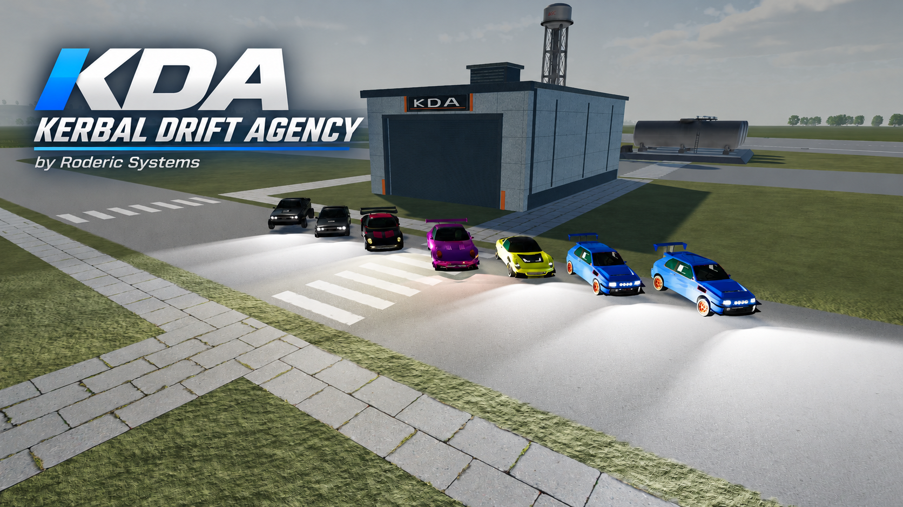
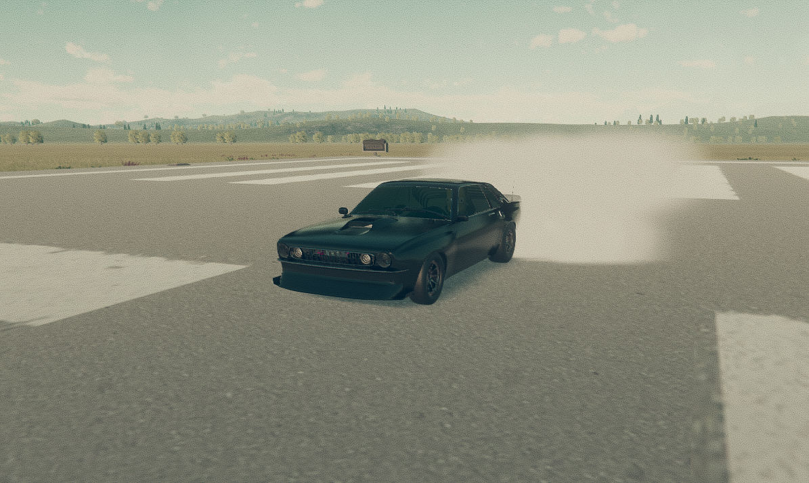
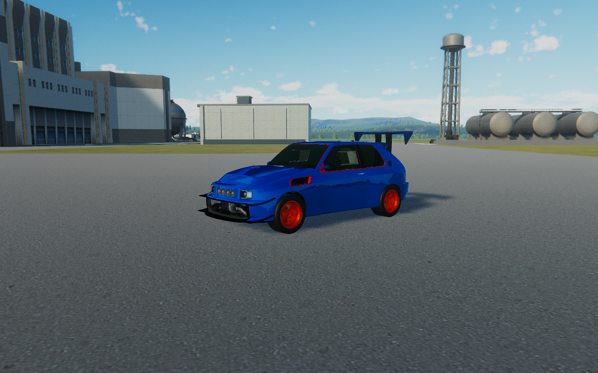
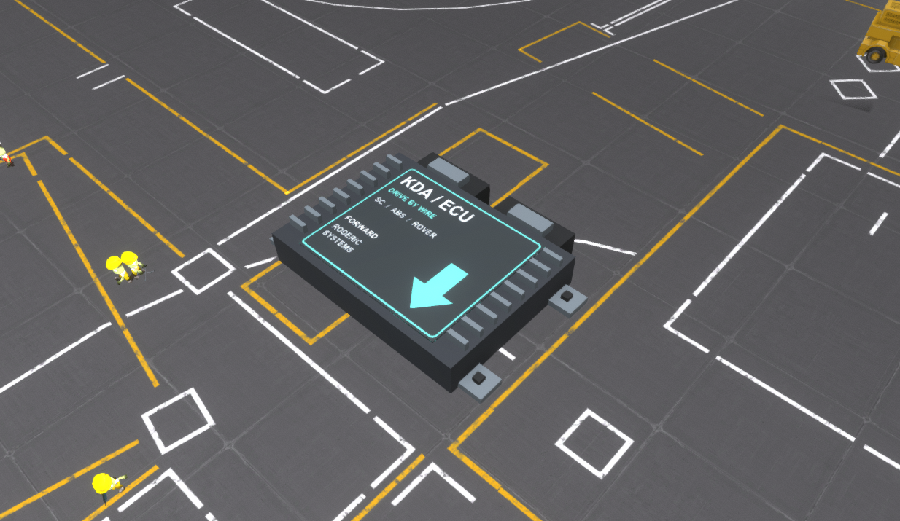
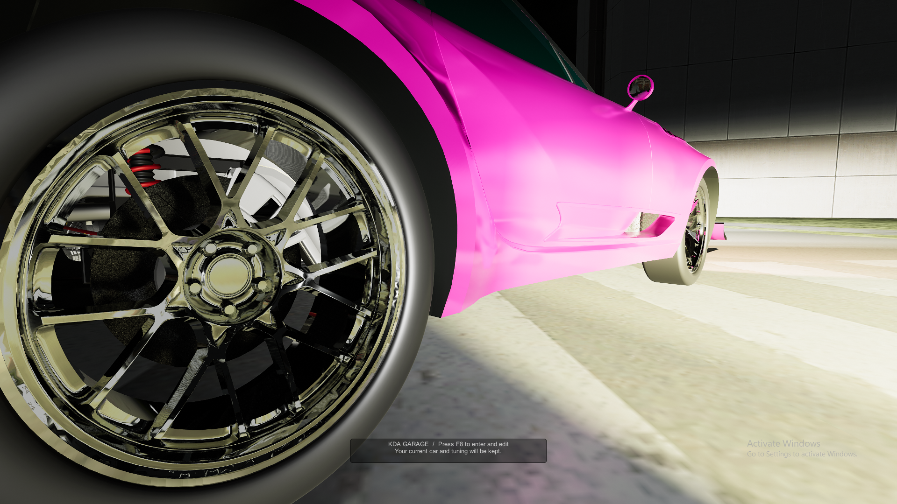
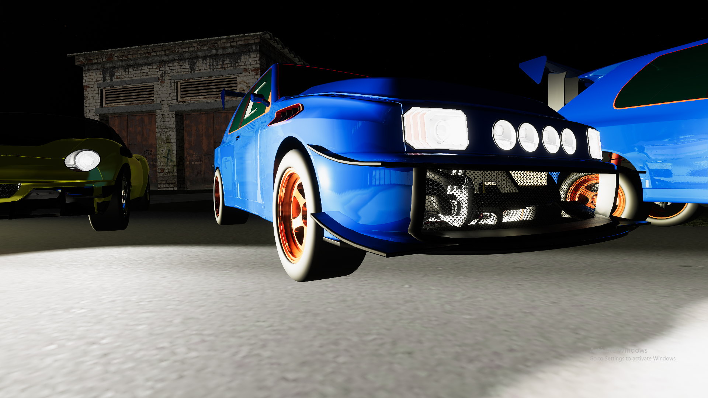
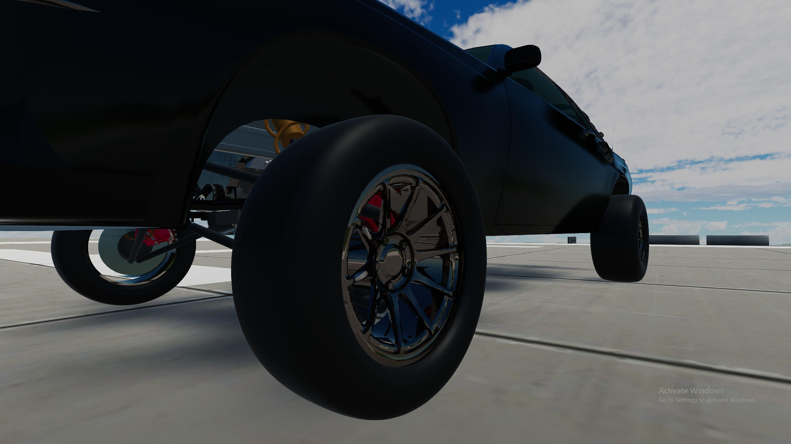

# Kerbal Drift Agency

**Vehicle driving, tuning and Automation imports for Kerbal Space Program 1.12.5.**

By **Roderic Systems**. Runtime **kda25** / Converter **V2.0 kda12**.

## Download

Get the [latest release](https://github.com/RodBot9999/Kerbal-Drift-Agency-Release/releases/latest), or download the packages below:

- [KDA GameData + included cars](https://github.com/RodBot9999/Kerbal-Drift-Agency-Release/releases/download/v1.0.0/KDA-kda25-GameData.zip) — install this in KSP.
- [Windows vehicle converter](https://github.com/RodBot9999/Kerbal-Drift-Agency-Release/releases/download/v1.0.0/KDA-Converter-v2-kda12.zip) — import your own Automation cars.
- [Complete corresponding source](https://github.com/RodBot9999/Kerbal-Drift-Agency-Release/releases/download/v1.0.0/KDA-kda25-complete-source.zip) — runtime, converter and build tools.
- [SHA-256 checksums](https://github.com/RodBot9999/Kerbal-Drift-Agency-Release/releases/download/v1.0.0/SHA256SUMS.txt).

The release packages include the manuals and licenses. External dependencies are
downloaded separately using the links below. You do not need the full repository
to play.

## Included cars

| **Lizard GT — included** | **Rabbit X AWD — included** |
| --- | --- |
|  |  |
| Black, rear-wheel-drive V8. | Blue AWD rally car, supplied as **Rabbit Rally x (finished)**. |

**Both cars are included in the download.** Use **Cars → Prebuild Car** in the
garage for complete builds with their saved wheel, seat and doorway positions,
then assign a Kerbal before driving.

## Rover drive-by-wire ECU

Add the **KDA Rover Drive-by-Wire ECU** to a stock-wheel rover for adaptive
steering, stability and brake assistance, ABS, and pitch-under-braking protection.
Its **Unstable** and **Normal** profiles help manage difficult rovers while
retaining their native propulsion, tire grip and suspension.

**Mount it horizontally, labelled side up, with the arrow pointing toward the
front of the rover.** Exactly two front wheels steer while the ECU is enabled;
turning it off restores the original steering settings.

See the [Rover ECU setup and profiles guide](documentation/Rover%20ECU.md) for
wheel grouping, controls and installation details.

## In-game screenshots

| Chrome wheel finish | Rabbit grille and turbo |
| --- | --- |
|  |  |

**Long-travel suspension**

Screenshots show additional converted cars as examples. The download includes
Lizard GT and Rabbit Rally x; use the converter to import your own cars.

## Install

1. Install the dependencies below. Keep one copy of each dependency and KDA runtime.
2. With KSP closed, copy `GameData/KDAVehicles` into your KSP `GameData` folder.
3. For the optional world garage, also copy `GameData/KDAGarageBuilding` and install
   Kerbal Konstructs plus Custom Pre Launch Checks.
4. Open the KDA badge in the mod toolbar, then choose **Go to KDA Garage**.
5. Use **Cars → Prebuild Car** for a complete included car, or copy the supplied
   `Ships/SPH` craft into your save. Assign crew to the physical seat before driving.

Back up saves and existing mod files before upgrading. Third-party mods are not
embedded in this download.

## Dependencies

| Dependency | Version | Purpose |
| --- | --- | --- |
| [ModuleManager](https://github.com/sarbian/ModuleManager/releases/tag/v4.2.3) | 4.2.3 | **Required:** KDA part and crew patches |
| [HarmonyKSP](https://github.com/KSPModdingLibs/HarmonyKSP/releases/tag/2.2.1.0) | 2.2.1.0 | **Required:** massless seats/crew; also used by Shabby |
| [Shabby](https://github.com/KSPModdingLibs/Shabby/releases/tag/0.4.2) | 0.4.2 | PBR shader loading and material replacement |
| [Resurfaced](https://github.com/Tantares/Resurfaced/releases) | 1.2 | PBR shaders for paint, metal and other vehicle materials |
| [Kerbal Konstructs](https://github.com/KSP-RO/Kerbal-Konstructs/releases/tag/v1.12.3.0) | 1.12.3.0 | **Optional:** world garage building; SPH/VAB garage works without it |
| [Custom Pre Launch Checks](https://github.com/KSP-RO/CustomPreLaunchChecks/releases/tag/1.8.1.1) | 1.8.1.1 | **Required when using Kerbal Konstructs** |

## Drive and tune

- Cars / Build / Tune garage, prebuilt cars, showroom views, live suspension previews and graphs.
- Mod-toolbar garage menu, Return to SPH/VAB, and a bright motorsport workshop
  with matte checkerboard tiles and a Kerbal Drift Agency neon sign.
- Road, Sport, Race and Drift driving aids, ABS and export-dependent active AWD.
- Standard/Rally/Desert suspension, ride height, travel, track width, damping,
  anti-roll bars, brakes and separate front/rear tire grip.
- Original hybrid engine audio. Adjust Engine volume and Exhaust in the garage;
  Engine volume is also available from the part menu in flight.
- Grounded smoke, working imported lights, steering-wheel animation, dashboard,
  configurable exhaust effects and optional rechargeable nitrous.
- Optional rover ECU with Unstable and Normal profiles; native rover propulsion,
  tire grip and suspension are retained.

The optional KK building appears at its supplied KSC location automatically.
**The position is optional: press Ctrl+K in KK to move it.** Remove only
`KDAGarageBuilding/Garage/Garage-instances.cfg` to omit the default placement or
avoid duplicating a building you placed manually. SPH/VAB garage mode works
without KK.

## Import your own car

Run `Converter/KDAVehicleConverter.exe`. Select an **Automation BeamNG ZIP export**,
the **whole KSP installation folder** and a new output directory. Disable Merge
All Fixtures when exporting for separate detail where possible.

The converter runs offline, without AI or tokens. It installs cars only: install
the KDA base mod separately first. Native BeamNG mods and standalone `.car` files
are unsupported. For a new import, use Cars / Prebuild Car to assemble its wheels and doorway
marker, check their placement and add a physical KDA seat. Planned seats does not
create hidden crew slots.

See [Prebuilding cars](documentation/Prebuilding%20Cars.md) for included templates,
other imported chassis and duplicate prevention.

## Guides

- [Game systems PDF](documentation/Game%20Systems.pdf)
- [Stability control PDF](documentation/SC.pdf)
- [Converter PDF](documentation/Converter.pdf)
- [Easy AI prompts](documentation/Prompts.md) / [PDF](documentation/Prompts.pdf)
- [Technical AI context](documentation/AI%20Context.md) / [PDF](documentation/AI%20Context.pdf)
- [Garage](documentation/KDA%20Garage.md), [suspension](documentation/KDA%20Long%20Travel.md),
  [audio](documentation/Hybrid%20Audio.md), [nitrous](documentation/Nitrous.md),
  [rover ECU](documentation/Rover%20ECU.md)
- [Release notes](documentation/Release%20Notes.md)
- [Source and build instructions](source/README.md)

Material translation, grip and suspension articulation are approximations of
the source data. Unsupported suspension art may remain rigid; the four native
wheel contacts still provide suspension physics. No universal FPS guarantee is made.

## Support

For bugs, [open an issue](https://github.com/RodBot9999/Kerbal-Drift-Agency-Release/issues) with your KSP/KDA versions, installed dependencies, reproduction steps and relevant log excerpts. For handling problems, include a telemetry run when available.

## Licenses and credits

Runtime: **MIT**. Converter: **GPL-3.0-only**. Original audio/manual text:
**CC BY 4.0**. Branding and third-party assets have separate terms.
See [licenses](LICENSE.md), [asset terms](ASSET-LICENSES.md) and [credits](CREDITS.md).
Matching source and third-party notices are included in this repository.
